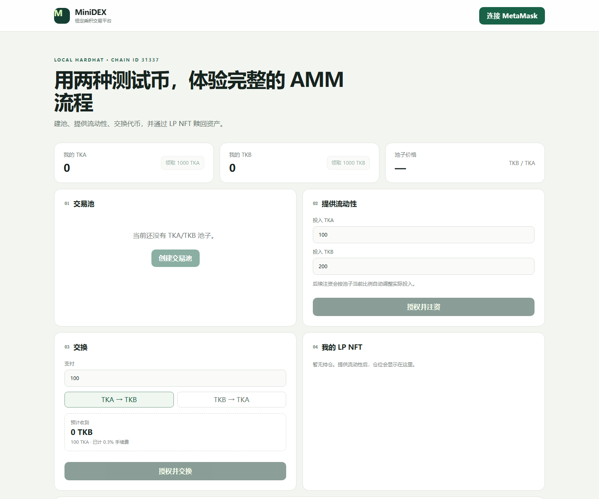
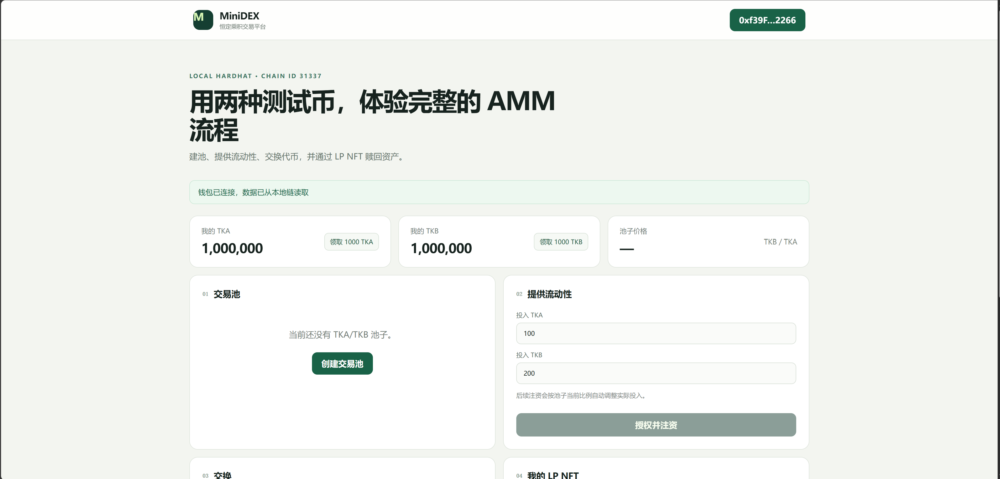
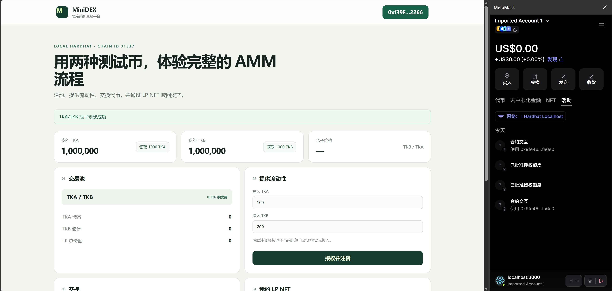
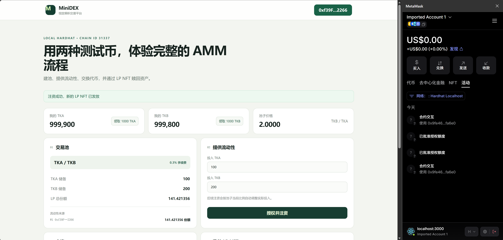
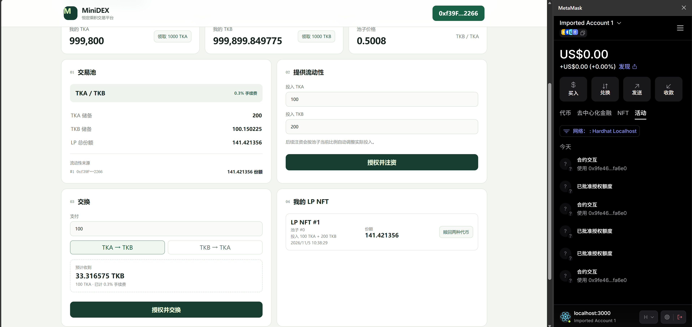
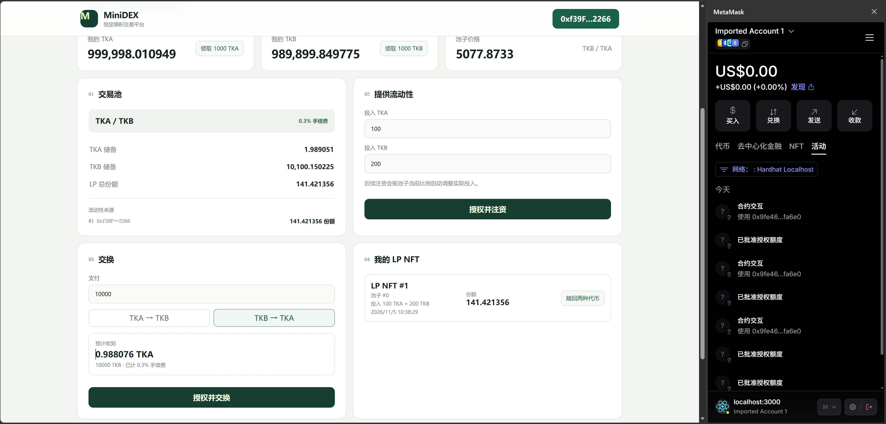
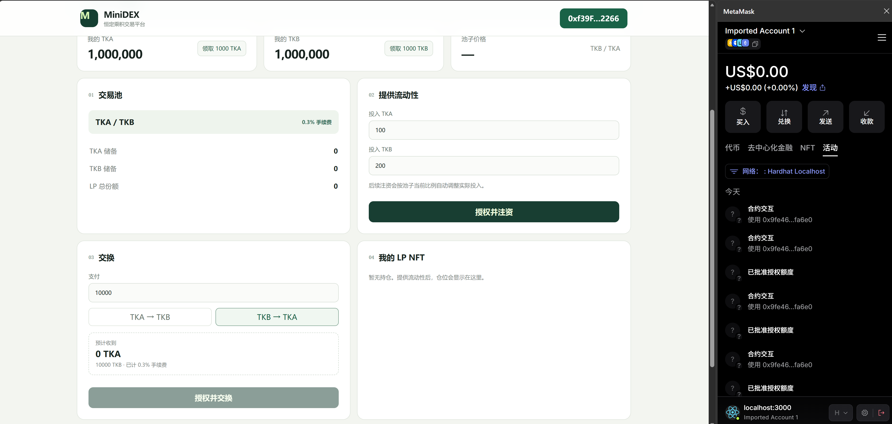
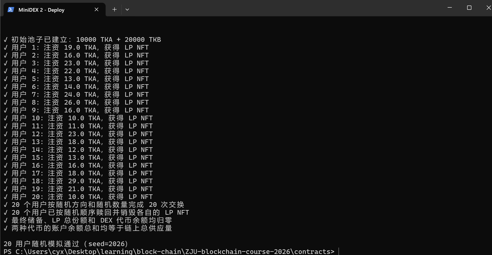
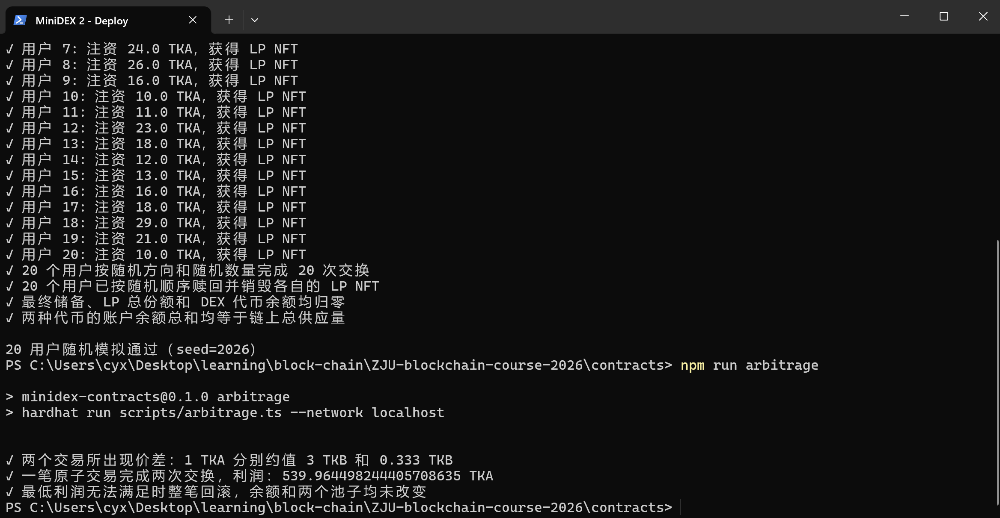

# MiniDEX：基于 AMM 的去中心化交易所

作者：陈元煦（3230104846）

## 如何运行

### 1. 准备环境

建议使用 Node.js 24，并在浏览器中安装 MetaMask。第一次运行时安装依赖：

```bash
cd contracts
npm ci

cd ../frontend
npm ci
```

### 2. 启动本地区块链

在项目根目录打开第一个终端：

```bash
cd contracts
npm run node
```

保持终端运行。节点地址为 `http://127.0.0.1:8545`，Chain ID 为 `31337`，提供 21 个带测试 ETH 的本地账户。

### 3. 部署合约

打开第二个终端：

```bash
cd contracts
npm run deploy
```

命令会依次部署 TKA、TKB 和 MiniDEX，并输出三个合约地址。

### 4. 启动前端

打开第三个终端：

```bash
cd frontend
npm run dev
```

访问 [http://localhost:3000](http://localhost:3000)，点击“连接 MetaMask”，确认连接并切换或添加 Hardhat 本地网络。

前端默认使用**全新节点上第一次执行部署脚本**所得的地址。如果部署顺序不同，请根据部署输出创建 `frontend/.env.local`：

```dotenv
VITE_TOKEN_A_ADDRESS=TKA地址
VITE_TOKEN_B_ADDRESS=TKB地址
VITE_MINIDEX_ADDRESS=MiniDEX地址
```

修改后重启前端。每次重启本地节点都会清空链上状态，需要重新部署并刷新页面。

### 5. 页面操作

1. 点击“创建交易池”并确认交易。
2. 分别领取 TKA、TKB；每个地址、每种代币限领一次。
3. 输入两种代币数量，点击“授权并注资”，依次确认两次授权和一次注资。
4. 注资成功后，页面显示 LP NFT、流动性来源和池子储备。
5. 选择交换方向并输入数量，确认授权和交换。
6. 在“我的 LP NFT”中点击“赎回两种代币”，销毁 NFT 并取回资产。

请只使用 Hardhat 提供的测试账户，不要将真实账户私钥用于本地开发。

### 6. 测试与演示

单元测试和构建：

```bash
cd contracts
npm test
npm run typecheck

cd ../frontend
npm test
npm run build
```

保持本地节点运行，在 `contracts/` 中还可以执行：

```bash
npm run smoke       # 部署、建池、注资、交换、赎回的完整流程
npm run simulate    # 20 用户随机操作及账目一致性检查
npm run arbitrage   # Bonus：两个交易所之间的原子套利与失败回滚演示
```

## 功能实现分析

## 项目运行截图

### 1. 前端首页



### 2. 连接 MetaMask 与测试代币



### 3. 创建交易池



### 4. 添加流动性并获得 LP NFT



### 5. TKA 兑换 TKB



### 6. TKB 兑换 TKA



### 7. 赎回流动性并销毁 LP NFT



### 8. 20 个模拟用户



### 9. Bonus：双交易所原子套利



## 参考内容

- [Uniswap V2 文档](https://docs.uniswap.org/contracts/v2/overview)
- [OpenZeppelin Contracts](https://docs.openzeppelin.com/contracts/)
- [Hardhat 文档](https://hardhat.org/docs)
- [ethers 文档](https://docs.ethers.org/v6/)
